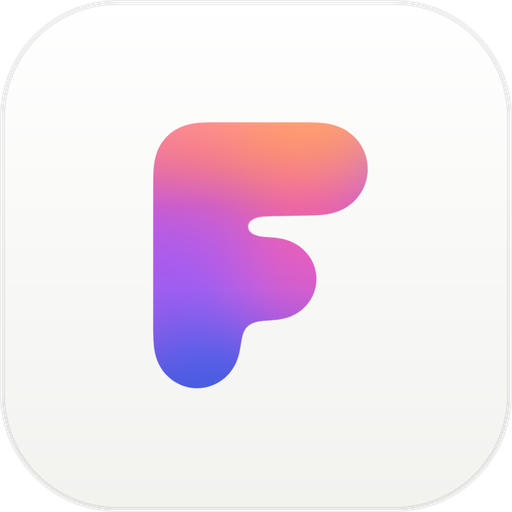
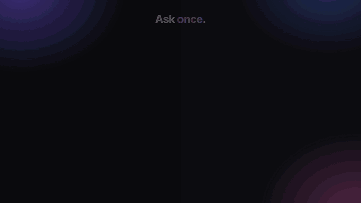
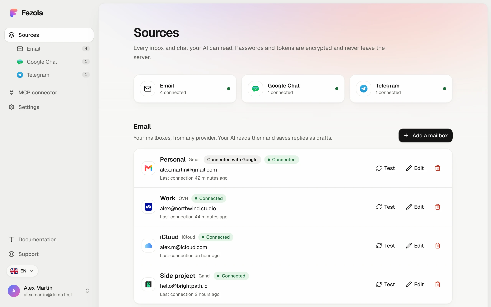
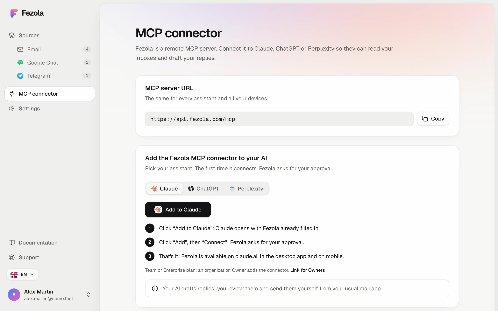
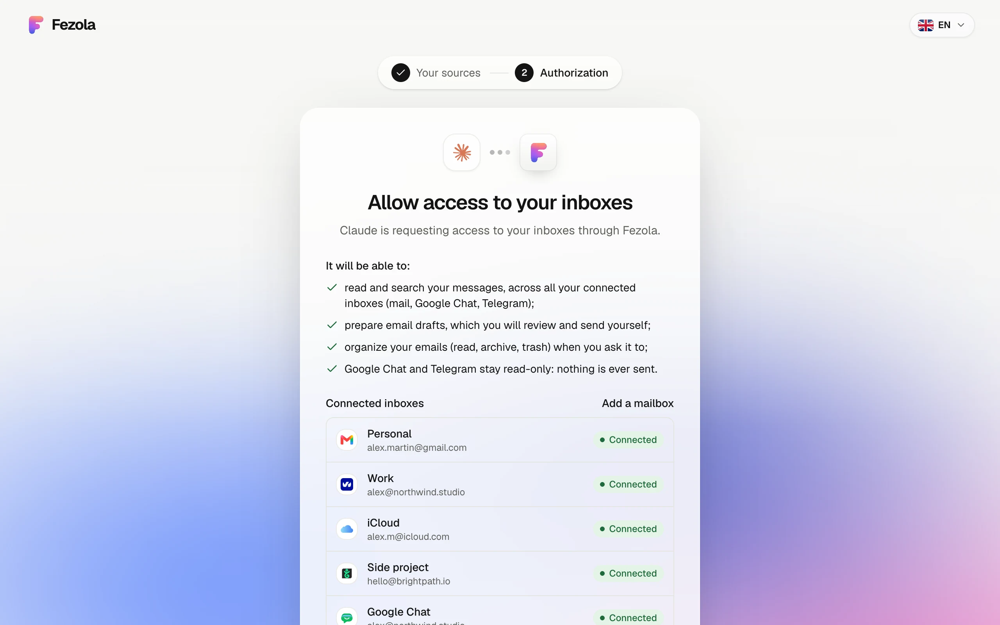

<p align="center">
  
</p>

<h1 align="center">Fezola: multi-account MCP server for email, chat, calendar, ad platforms and Notion</h1>

<p align="center">
  <b>One MCP connector for every account you own, across tools, with one shared Memory for all your assistants.</b><br>
  Gmail, Outlook.com, iCloud, OVH, IONOS, Gandi or any IMAP mailbox, Google Chat, Telegram, Google Calendar, Notion, Search Console, Cloudflare, PostHog, DataForSEO, Brevo, ElevenLabs, Zernio, Aircall, Atlassian, Linear and three ad platforms (Google Ads, Microsoft Advertising, OpenAI Ads), several accounts per tool, in Claude (and ChatGPT on Business plans), Cursor, VS Code and any MCP client.
</p>

<p align="center">
  <a href="https://app.fezola.com?utm_source=github&utm_medium=readme&utm_campaign=fezola-mcp">Website</a> ·
  <a href="https://app.fezola.com/en/docs?utm_source=github&utm_medium=readme&utm_campaign=fezola-mcp">Documentation</a> ·
  <a href="https://youtu.be/NPiCLqNoL_0">Demo video</a> ·
  <a href="https://app.fezola.com/en/pricing?utm_source=github&utm_medium=readme&utm_campaign=fezola-mcp">Pricing</a>
</p>

<p align="center">
  <a href="https://claude.ai/customize/connectors?modal=add-custom-connector&connectorName=Fezola&connectorUrl=https%3A%2F%2Fapi.fezola.com%2Fmcp"></a>
  <a href="https://cursor.com/en/install-mcp?name=fezola&config=eyJ1cmwiOiJodHRwczovL2FwaS5mZXpvbGEuY29tL21jcCJ9"></a>
  <a href="https://insiders.vscode.dev/redirect/mcp/install?name=fezola&config=%7B%22type%22%3A%22http%22%2C%22url%22%3A%22https%3A//api.fezola.com/mcp%22%7D"></a>
</p>

<p align="center">
  <a href="https://github.com/Sagargupta16/awesome-mcp-servers"></a>
</p>

---

Most people have more than one inbox: a personal Gmail, a work address, a custom domain on iCloud, OVH, IONOS, Gandi or Fastmail, a Google Chat, a Telegram, two Google Calendars, several ad accounts (Google Ads, Microsoft Advertising, OpenAI Ads), a couple of Notion workspaces. Fezola is a **hosted remote MCP server** (email over IMAP, plus Gmail OAuth, Outlook.com, Google Chat, Telegram, Google Calendar, Google Ads, Microsoft Advertising, OpenAI Ads, Google Search Console, Notion, Cloudflare, PostHog, DataForSEO, Brevo, ElevenLabs, Zernio, Aircall, Atlassian and Linear) that puts all of them behind a single connector, so Claude, ChatGPT or any MCP client can answer "what needs my reply today?" across everything. Drafts land in the inbox that got the mail.

Looking for an **IMAP MCP server** without running one yourself? Add your IMAP host and password (an app password for iCloud or Gmail) once on [fezola.com](https://fezola.com), then connect `https://api.fezola.com/mcp` with OAuth: no Docker, no local process, no credentials in your MCP client config.

[](https://youtu.be/NPiCLqNoL_0)

> This repository holds the public documentation and client configuration for the hosted Fezola service. The server itself is closed source and runs at `https://api.fezola.com/mcp`.

<p align="center">
  
</p>

## Connect

| | |
|---|---|
| **Server URL** | `https://api.fezola.com/mcp` |
| **Transport** | Streamable HTTP |
| **Authentication** | OAuth 2.1 with PKCE and dynamic client registration. You sign in to Fezola and approve the assistant on a consent screen. No API key to copy. |
| **Registry** | Official MCP Registry: `com.fezola.app/fezola` |

First create a free account at [app.fezola.com](https://app.fezola.com?utm_source=github&utm_medium=readme&utm_campaign=fezola-mcp) and add your mailboxes and chats. Then add the connector to your client:

### Claude (claude.ai, Desktop, mobile)

Use the **Add to Claude** button above (it opens the form already filled in), or go to Settings > Connectors > **Add custom connector**, name it `Fezola`, paste `https://api.fezola.com/mcp`, then sign in.

### ChatGPT

In ChatGPT, open Settings > Apps & Connectors > Advanced settings and turn on **Developer mode**. Back in Apps & Connectors, click **Create**, name it `Fezola`, paste `https://api.fezola.com/mcp` and choose **OAuth**. Paid plans only (Plus, Pro, Business), on chatgpt.com.

### Perplexity

Settings > Connectors > **+ Custom connector**, choose **Remote**, name it `Fezola`, paste the URL and choose **OAuth**. Pro and Max plans.

### Claude Code

```bash
claude mcp add --transport http fezola https://api.fezola.com/mcp
```

Or as a plugin, from this repository's marketplace:

```bash
/plugin marketplace add mehdis34/fezola-mcp
/plugin install fezola@fezola
```

### Gemini CLI

```bash
gemini extensions install https://github.com/mehdis34/fezola-mcp
```

Then run `/mcp auth fezola` to sign in.

### Cursor

Use the **Add to Cursor** button above, or add it to `~/.cursor/mcp.json`:

```json
{
  "mcpServers": {
    "fezola": { "url": "https://api.fezola.com/mcp" }
  }
}
```

### VS Code

Use the **Install in VS Code** button above, or add it to `.vscode/mcp.json`:

```json
{
  "servers": {
    "fezola": { "type": "http", "url": "https://api.fezola.com/mcp" }
  }
}
```

Any other client that supports remote MCP servers with OAuth works the same way: give it the URL and follow the sign-in.

## What you can ask

- "What needs my reply today?" One briefing across every mailbox, Google Chat and Telegram.
- "Find the OVH invoice from last month." One search over all accounts, attachments included (PDF, Word, images).
- "Summarize the thread with Paul and draft a reply." The draft lands in the mailbox that received the email; you review and send.
- "Archive the newsletters from this week" or "move this to Receipts."
- "When am I free on Thursday across my two calendars?" Then create the event in the right one.
- "How did my campaigns do last week across every Google Ads account? Pause the ones over budget." Changes can be checked first, and new campaigns start paused. The same goes for Microsoft Advertising (no simulation mode there) and OpenAI Ads (changes are simulated first).
- "Find the onboarding page in my Notion workspaces."
- "Which pages gained clicks in Search Console this month?" Several Google accounts, one answer.
- "Show last week's Cloudflare traffic" or "list the DNS records of my domain": Cloudflare, PostHog, DataForSEO, Brevo, ElevenLabs, Zernio (social media), Atlassian and Linear are reached through the relayed-services tools, several accounts each.

## Tools

| Area | Tools |
|---|---|
| Accounts | `list_accounts`, `test_connection`, `rename_account`, `remove_account`, `get_connect_link`, `get_connection_help` |
| Mail: read | `list_recent`, `search_messages`, `get_message`, `get_thread`, `get_attachment`, `list_folders` |
| Mail: drafts | `create_draft`, `reply_draft`, `forward_draft`, `update_draft`, `list_drafts`, `delete_draft` |
| Mail: organize | `mark_as_read`, `mark_as_unread`, `flag_message`, `move_message`, `archive_message`, `trash_message`, `mark_as_spam` |
| Google Chat (read-only) | `list_chat_spaces`, `list_recent_chat`, `search_chat`, `get_chat_thread` |
| Telegram (read-only) | `list_telegram_chats`, `list_recent_telegram`, `search_telegram`, `get_telegram_chat` |
| Google Calendar | `list_calendar_events`, `find_free_time`, `create_calendar_event`, `update_calendar_event`, `delete_calendar_event` |
| Google Ads | `google_ads_list_accounts`, `google_ads_search`, `google_ads_campaign_performance`, `google_ads_keyword_ideas`, `google_ads_mutate`, `google_ads_set_status`, `google_ads_set_budget` |
| Microsoft Advertising | `msads_list_accounts`, `msads_campaigns`, `msads_ad_groups`, `msads_ads`, `msads_keywords`, `msads_performance`, `msads_create_campaign`, `msads_update_campaign`, `msads_set_status`, `msads_set_budget`, `msads_add_keywords`, `msads_delete` |
| OpenAI Ads | `openai_ads_list_accounts`, `openai_ads_campaigns`, `openai_ads_ad_groups`, `openai_ads_ads`, `openai_ads_insights`, `openai_ads_conversions_insights`, `openai_ads_pixels`, `openai_ads_geo_lookup`, `openai_ads_create_campaign`, `openai_ads_update_campaign`, `openai_ads_set_campaign_status` |
| Google Search Console | `search_console_list_properties`, `search_console_add_property`, `search_console_performance`, `search_console_inspect_url`, `search_console_list_sitemaps`, `search_console_get_sitemap`, `search_console_submit_sitemap`, `search_console_delete_sitemap` |
| Aircall | `aircall_list_accounts`, `aircall_list_calls`, `aircall_get_call`, `aircall_comment_call`, `aircall_tag_call`, `aircall_list_tags`, `aircall_list_numbers`, `aircall_list_users`, `aircall_list_teams`, `aircall_search_contacts`, `aircall_get_contact`, `aircall_create_contact`, `aircall_update_contact` |
| Memory | `remember`, `recall`, `update_memory`, `forget`, `list_memories` |
| Relayed services (Notion, Cloudflare, PostHog, DataForSEO, Brevo, ElevenLabs, Zernio, Atlassian, Linear) | `search_connector_tools`, `call_connector_tool` |
| Profile and access | `get_profile`, `update_profile`, `list_connected_assistants`, `revoke_assistant` |
| Plan | `get_plan`, `get_upgrade_link`, `get_billing_portal_link`, `list_invoices` |

In beta: Meta Ads and custom MCP servers (any remote MCP server you add yourself). New tools appear without reconnecting Fezola in Claude or ChatGPT.

`send_message` exists but is **off by default**: Fezola saves drafts and you send them yourself. Every tool carries MCP annotations (read-only, destructive, idempotent) so clients can ask for confirmation where it matters.

## Guides

- [Multiple Gmail accounts in Claude](https://app.fezola.com/en/guides/multiple-gmail-accounts-in-claude?utm_source=github&utm_medium=readme&utm_campaign=fezola-mcp)
- [All your inboxes in Claude](https://app.fezola.com/en/guides/all-your-inboxes-in-claude?utm_source=github&utm_medium=readme&utm_campaign=fezola-mcp)
- [IMAP MCP server](https://app.fezola.com/en/guides/imap-mcp-server?utm_source=github&utm_medium=readme&utm_campaign=fezola-mcp)
- [Outlook.com and Hotmail in Claude and ChatGPT](https://app.fezola.com/en/blog/outlook-hotmail-claude-chatgpt?utm_source=github&utm_medium=readme&utm_campaign=outlook)
- [iCloud Mail in Claude](https://app.fezola.com/en/guides/icloud-mail-in-claude?utm_source=github&utm_medium=readme&utm_campaign=fezola-mcp)
- [Yahoo Mail in Claude and ChatGPT](https://app.fezola.com/en/guides/yahoo-mail-in-claude-and-chatgpt?utm_source=github&utm_medium=readme&utm_campaign=fezola-mcp)
- [Google Chat in Claude and ChatGPT](https://app.fezola.com/en/guides/google-chat-in-claude-and-chatgpt?utm_source=github&utm_medium=readme&utm_campaign=fezola-mcp)
- [Telegram in Claude and ChatGPT](https://app.fezola.com/en/guides/telegram-in-claude-and-chatgpt?utm_source=github&utm_medium=readme&utm_campaign=fezola-mcp)
- [Is it safe to connect your email to AI?](https://app.fezola.com/en/guides/is-it-safe-to-connect-email-to-ai?utm_source=github&utm_medium=readme&utm_campaign=fezola-mcp)

## Security and privacy

- Messages are read live when the assistant asks. Fezola does not store your emails or chats.
- Mailbox passwords and OAuth tokens are encrypted at rest and never leave the server.
- Each access token only sees the accounts of the user who approved it. You can revoke any assistant at any time.
- Google Chat and Telegram access is read-only.
- Full details: [privacy policy](https://app.fezola.com/en/privacy?utm_source=github&utm_medium=readme&utm_campaign=fezola-mcp). Vulnerability reports: [security.txt](https://app.fezola.com/.well-known/security.txt).

## Plans

- **Free**: 2 sources.
- **Pro**: unlimited sources, 9 EUR or USD per month or 90 per year, 7-day free trial.

## Screenshots

| Your sources | The connector | Consent |
|---|---|---|
|  |  |  |

## Support

- Email: [support@fezola.com](mailto:support@fezola.com)
- Issues and feature requests: [open an issue](../../issues) in this repository. Which channel should come next: Outlook, Slack, WhatsApp Business?

## License

The documentation and configuration examples in this repository are under the [MIT License](LICENSE). The Fezola service is proprietary.
